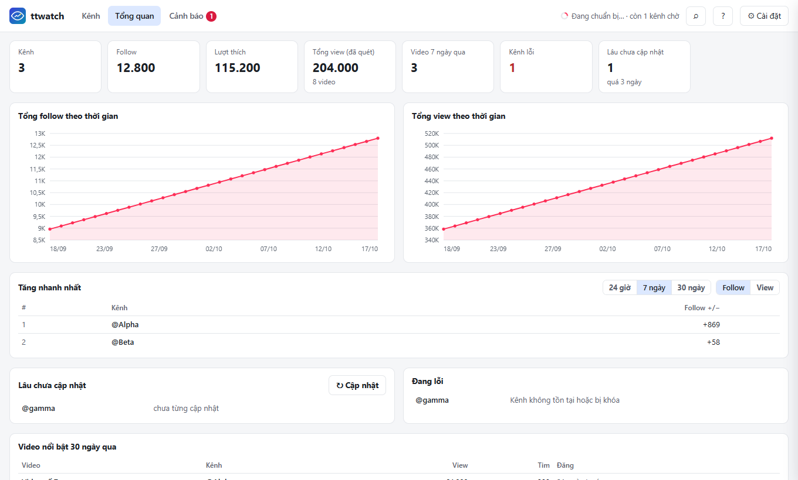

# ttwatch — theo dõi kênh TikTok, bản source để tự phát triển

Tên cũ của repo là `channel-watch`. Tên dữ liệu và biến môi trường (`TheoDoiKenhTiktok_data`, `TDK_DATA_DIR`) giữ nguyên để không mất dữ liệu đã quét.

Dựng lại từ `TheoDoiKenhTiktok.exe` (PyInstaller, Python 3.13). `recovered/` là bản dựng lại từ bytecode, khớp từng code object với bản gốc và có script kiểm chứng. Mã ở thư mục gốc dựng từ đó, thêm các phần có chủ đích ghi ở `docs/scraper-diff.md`.

> **Nguồn gốc và lưu ý.** Đây là bản dựng lại không chính thức, dùng cho mục đích cá nhân, từ công cụ
> `TheoDoiKenhTiktok.exe` do một tác giả khác chia sẻ. Giao diện trong `static/` (logo, bố cục, văn bản) lấy từ gói
> gốc và thư mục `recovered/` là mã dựng lại từ chính bytecode của nó. Quyền với các phần đó thuộc về tác giả gốc;
> repo này không cấp giấy phép nào cho chúng. Phần mới (`insights.py`, `charts.js`, `panels.js`, test, CI…) do
> chủ repo viết. Nếu bạn là tác giả gốc và muốn gỡ hoặc ghi công khác đi, hãy mở issue.

## Tính năng

- **Kênh**: bảng theo dõi follow, tim, view, tương tác %, mức tăng so với lần trước, xu hướng 30 ngày, nhóm, ghi chú; chọn nhiều, menu chuột phải, xuất Excel.
- **Tổng quan**: tổng follow/view theo thời gian, kênh tăng nhanh nhất (24 giờ / 7 / 30 ngày), kênh lâu chưa cập nhật, kênh lỗi, video nổi bật.
- **Chi tiết kênh** (Space): biểu đồ lịch sử follow/tim/view/video, phân bố view, giờ đăng hiệu quả, top video, video vượt trội.
- **So sánh** 2–6 kênh trên cùng một biểu đồ.
- **Cảnh báo**: follow đổi vượt ngưỡng %, kênh có video mới; hiện trong tab Cảnh báo và bóng thông báo ở khay.
- **Danh sách video** mỗi kênh: tóm tắt, phân tích theo bộ lọc, đánh dấu video vượt trội, xuất Excel/CSV.
- **Nhập kênh** từ file txt/csv (kèm nhóm, ghi chú), **chế độ xem đã lưu**, **bảng lệnh** Ctrl+K, **hoàn tác xóa**.
- **Tự cập nhật** theo chu kỳ, có giờ yên lặng; **sao lưu tự động** mỗi ngày và trước khi nâng cấp dữ liệu.

Hướng dẫn dùng ở `docs/user-guide.md`, lịch sử thay đổi ở `CHANGELOG.md`.



## Chạy

```bash
uv venv --python 3.13 .venv
uv pip install --python .venv/Scripts/python.exe -r requirements.txt
.venv/Scripts/python -m playwright install chromium
.venv/Scripts/python app.py
```

Trang mở tại `http://127.0.0.1:8765/` (cổng đầu tiên còn trống trong 8765–8774). Chạy từ source thì dữ liệu nằm cạnh `app.py`; bản đóng gói thì ở `TheoDoiKenhTiktok_data` cạnh exe (hoặc `%LOCALAPPDATA%\TheoDoiKenhTiktok` nếu không ghi được). Đặt `TDK_DATA_DIR` để trỏ sang thư mục khác. `NO_OPEN=1` không mở trình duyệt, `NO_TRAY=1` không hiện biểu tượng khay.

Tool chỉ đọc trang TikTok công khai bằng trình duyệt của máy bạn. Không gửi dữ liệu đi đâu khác. Kênh riêng tư và captcha vẫn chặn như bản gốc.

## CI và phát hành

- `.github/workflows/ci.yml`: mỗi lần push/PR chạy ruff, kiểm tra cú pháp JS và toàn bộ test (kể cả giao diện với Chrome) trên Windows.
- `.github/workflows/release.yml`: đẩy tag `v*` (ví dụ `git tag v0.1.0 && git push origin v0.1.0`) thì build exe, chạy thử exe (ping, trang chủ, tắt), nén zip kèm SHA256 và tạo GitHub Release. Chạy tay ở tab Actions thì chỉ tạo artifact.

Máy khác chỉ cần tải zip ở mục Releases, giải nén và chạy `TheoDoiKenhTiktok.exe`; dữ liệu nằm trong `TheoDoiKenhTiktok_data` cạnh exe.

## Kiểm thử

```bash
uv pip install --python .venv/Scripts/python.exe -r requirements-dev.txt
TDK_DATA_DIR=$(mktemp -d) .venv/Scripts/python -m pytest -q
.venv/Scripts/ruff check --select F,E9 .
```

Cần đặt `TDK_DATA_DIR` sang thư mục trống: app từ chối chạy khi hai bản dùng chung một thư mục dữ liệu. Test giao diện (`tests/test_ui.py`) mở trình duyệt thật (Chrome/Edge/Chromium của Playwright) với dữ liệu giả, không gọi TikTok, và tự bỏ qua nếu máy không có trình duyệt. Ảnh chụp lưu ở `docs/screens/`.

Kiểm chứng bản dựng lại với exe gốc: xem `recovered/README.md`.

## Đóng gói exe

```powershell
powershell -File build.ps1      # tạo dist\TheoDoiKenhTiktok\TheoDoiKenhTiktok.exe (~150 MB cả thư mục)
```

Cần `uv` trong PATH; script tự cài PyInstaller vào `.venv`. `build/`, `dist/`, `*.spec` đã được ignore. Exe dùng Edge/Chrome có sẵn của máy.

## Cấu trúc

| File | Vai trò |
|---|---|
| `app.py` | FastAPI: API, trang tĩnh, xuất file, khởi động |
| `scraper.py` | Playwright, hàng đợi quét, thử lại, tự làm mới |
| `db.py` | SQLite, migration có version, sao lưu |
| `insights.py` | lịch sử, tổng quan, phân tích, so sánh, cảnh báo, chế độ xem |
| `instance_lock.py` | khóa một bản chạy trên thư mục dữ liệu |
| `tray.py`, `paths.py` | khay hệ thống, đường dẫn dữ liệu |
| `static/` | giao diện (không cần npm): `main.js` bảng kênh, `panels.js` các màn mới, `charts.js` biểu đồ SVG |
| `recovered/` | bản dựng lại từ bytecode gốc, chỉ để tham chiếu và kiểm chứng |
